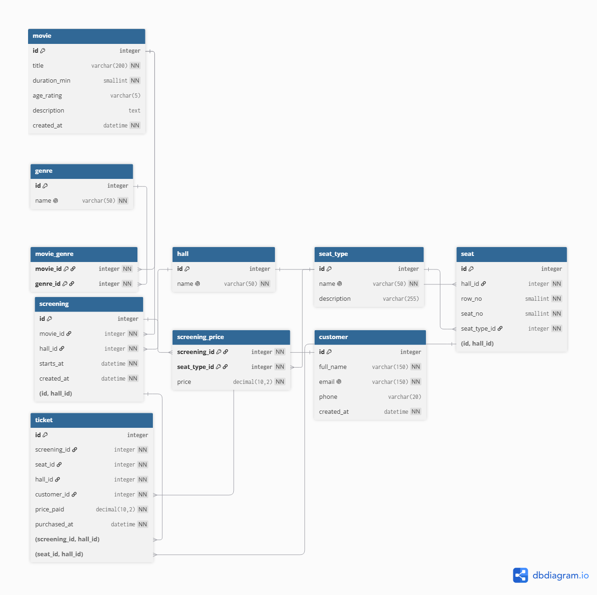

# PSPA

Учебный проект на PHP + Docker. Внутри три независимые части:

1. **Проверка скобочной последовательности**: HTTP-сервис (nginx, PHP-FPM, Redis).
2. **Верификация email**: веб-страница и класс `EmailVerifier`.
3. **База данных кинотеатра**: домашнее задание по проектированию БД (MySQL) со страницей визуализации.

## Содержание
- [Архитектура](#архитектура)
- [Быстрый старт](#быстрый-старт)
- [1. Проверка скобок](#1-проверка-скобок)
- [2. Верификация email](#2-верификация-email)
- [3. База данных кинотеатра](#3-база-данных-кинотеатра)
- [Тесты](#тесты)
- [Структура проекта](#структура-проекта)
- [Полезные команды](#полезные-команды)

## Архитектура

```
Клиент ──> nginx-lb (:80, least_conn)
              ├──> nginx-backend-1 ──> php-fpm-1 ─┐
              └──> nginx-backend-2 ──> php-fpm-2 ─┼──> redis  (сессии PHP)
                                                  └──> mysql  (база кинотеатра, порт 3306)
```

| Сервис | Контейнер | Назначение |
|---|---|---|
| `nginx-lb` | `pspa-nginx-lb` | Единственная точка входа, порт 80. Балансирует запросы между двумя бэкендами |
| `nginx-backend-1`, `nginx-backend-2` | `pspa-nginx-backend-*` | Отдают статику и передают PHP-запросы в FPM |
| `php-fpm-1`, `php-fpm-2` | `pspa-php-*` | PHP 8.2 (расширения `redis` и `pdo_mysql`) |
| `redis` | `pspa-redis` | Хранилище PHP-сессий (`session.save_handler = redis`) |
| `mysql` | `pspa-mysql` | MySQL 8.0, база `pspa_db`, данные в томе `mysql-data` |

Код приложения (`app/`) монтируется в контейнеры, поэтому изменения PHP применяются без пересборки.

## Быстрый старт

Нужен Docker (Docker Desktop на Windows).

```bash
docker compose -f docker-compose.yml up --build -d
```

> Флаг `-f docker-compose.yml` обязателен. В папке лежит ещё `compose.yaml` (заготовка расширения Docker для VS Code),
> и без `-f` Compose выберет именно его.

После первого запуска подождите 10–15 секунд, пока MySQL выполнит скрипты инициализации.
Готовность видно в логе: `docker logs pspa-mysql --tail 3` (строка `ready for connections`).

Остановка:

```bash
docker compose -f docker-compose.yml down        # остановить, данные БД сохраняются
docker compose -f docker-compose.yml down -v     # остановить и удалить данные БД
```

Страницы после запуска:

| Адрес | Что это |
|---|---|
| http://localhost/cinema.php | Визуализация базы кинотеатра |
| http://localhost/email.php | Верификация email |
| `POST http://localhost/` | Проверка скобочной последовательности |

## 1. Проверка скобок

Точка входа: [app/public/index.php](app/public/index.php), логика: [app/src/BracketValidator.php](app/src/BracketValidator.php).

Сервис принимает **POST**-параметр `string` и проверяет, что строка состоит только из `(` и `)` и скобки сбалансированы.

| Ответ | Когда |
|---|---|
| `200 OK` | Последовательность корректна |
| `400 Bad Request` | Пустая строка, посторонние символы, закрывающая скобка раньше открывающей, незакрытые скобки, метод не POST |

Примеры:

```bash
# корректная последовательность, ответ 200
curl -i -X POST 'http://localhost/' --data-urlencode 'string=(()()())'

# некорректная, ответ 400
curl -i -X POST 'http://localhost/' --data-urlencode 'string=)(('
```

Результат последней проверки сохраняется в PHP-сессии (`$_SESSION['last_status']`), сессии лежат в Redis.
GET-запрос к `/` тоже вернёт 400, потому что поддерживается только POST.

## 2. Верификация email

Страница: [app/public/email.php](app/public/email.php), логика: [app/src/EmailVerifier.php](app/src/EmailVerifier.php).

Вводите по одному адресу на строку и нажимаете «Проверить». Для каждого адреса проверяется:

1. **Формат.** Длина адреса не больше 254 символов, локальная часть не больше 64, ровно один `@`, допустимые символы, точки не в начале, не в конце и не подряд. Домен должен состоять из корректных меток. Поддерживаются Unicode-адреса.
2. **MX-запись домена.** Через DNS (`getmxrr`). Домены на кириллице переводятся в punycode (`idn_to_ascii`).

Результат: «валидный» или «невалидный» с причиной (`ok`, `bad format`, `no MX record`).
Результаты MX-проверки кэшируются по домену, поэтому на списке адресов с одним доменом DNS опрашивается один раз.
Для тестов DNS-резолвер подменяется через конструктор `EmailVerifier`.

Страница работает и без отправки формы: `http://localhost/email.php?run=1` проверит адреса из примера.

## 3. База данных кинотеатра

Домашнее задание: спроектировать БД для управления кинотеатром (залы, сеансы, билеты),
описать её через DDL и найти самый прибыльный фильм.
Подробное описание модели и принятых решений: [db/README.md](db/README.md).

### Логическая модель (ER-диаграмма)



Диаграмма построена в [dbdiagram.io](https://dbdiagram.io), исходный текст схемы: [db/schema.dbml](db/schema.dbml)
(его можно вставить на dbdiagram.io, чтобы открыть и отредактировать диаграмму).

### Модель

Таблицы: `movie`, `genre`, `movie_genre` (M:N), `hall`, `seat_type`, `seat`, `screening` (сеанс), `screening_price`, `customer`, `ticket`.

Ключевые идеи:
- **Цена зависит от сеанса и категории места.** Таблица `screening_price (screening_id, seat_type_id, price)`.
  Фактическая цена продажи хранится в `ticket.price_paid`, смена прайса не меняет выручку по проданным билетам.
- **Схема зала.** Таблица `seat`: зал, ряд, место, категория (обычное, диван, VIP).
- **Нельзя продать одно место дважды.** `UNIQUE (screening_id, seat_id)` в `ticket`.
- **Место принадлежит залу сеанса.** Составные внешние ключи `(screening_id, hall_id)` и `(seat_id, hall_id)` в `ticket`.
- **`CHECK`-ограничения.** Длительность фильма больше 0, номера ряда и места больше 0, цены не меньше 0.

### Файлы

| Файл | Назначение |
|---|---|
| [db/er-diagram.png](db/er-diagram.png) | ER-диаграмма (логическая модель) |
| [db/schema.dbml](db/schema.dbml) | Исходный текст диаграммы для dbdiagram.io |
| [db/init/01_schema.sql](db/init/01_schema.sql) | DDL: таблицы, ключи, индексы, ограничения |
| [db/init/02_seed.sql](db/init/02_seed.sql) | Тестовые данные: 4 фильма, 2 зала, 39 мест, 8 сеансов, 30 билетов |
| [db/query.sql](db/query.sql) | Запрос на самый прибыльный фильм |
| [app/public/cinema.php](app/public/cinema.php) | Визуализация |

Скрипты из `db/init/` выполняются автоматически, но **только при первом старте на пустом томе**.
Чтобы применить их заново после изменений:

```bash
docker compose -f docker-compose.yml down -v
docker compose -f docker-compose.yml up -d
```

### Самый прибыльный фильм

```sql
SELECT m.id, m.title, COUNT(t.id) AS tickets_sold, SUM(t.price_paid) AS revenue
FROM ticket t
JOIN screening s ON s.id = t.screening_id
JOIN movie m     ON m.id = s.movie_id
GROUP BY m.id, m.title
ORDER BY revenue DESC
LIMIT 1;
```

На тестовых данных результат: **«Космический рубеж», 6500.00** (11 билетов).
У «Смеха до слёз» билетов больше (14), но они дешевле, поэтому его выручка ниже (3180.00).

Выполнить запрос:

```bash
docker exec -i pspa-mysql mysql -upspa_user -ppspa_password pspa_db --default-character-set=utf8mb4 < db/query.sql
```

### Подключение к базе

| Параметр | Из контейнеров | С хоста |
|---|---|---|
| Хост | `mysql` | `127.0.0.1` |
| Порт | 3306 | 3306 |
| База | `pspa_db` | `pspa_db` |
| Пользователь / пароль | `pspa_user` / `pspa_password` | `pspa_user` / `pspa_password` |

Консоль MySQL:

```bash
docker exec -it pspa-mysql mysql -upspa_user -ppspa_password pspa_db --default-character-set=utf8mb4
```

Если на компьютере запущен MySQL из XAMPP, порт 3306 будет занят. Замените в `docker-compose.yml` `"3306:3306"` на `"3307:3306"`.
Для контейнеров ничего не изменится.

### Страница визуализации

http://localhost/cinema.php показывает:
- самый прибыльный фильм и выручку по всем фильмам (горизонтальные полосы);
- список сеансов с занятостью (`занято / всего мест`);
- схему зала выбранного сеанса: ряды, места, категории (обычное, диван, VIP), занятые места, цены в подсказках и легенде.

Учебные пароли в `docker-compose.yml` не предназначены для реальных систем.

## 4. Анализ YouTube-каналов (Elasticsearch)

Веб-интерфейс: http://localhost/youtube.php. Индексы `channels` и `videos` в Elasticsearch 8, модели, репозитории и класс статистики (сумма лайков и дизлайков канала, топ каналов по отношению лайков к дизлайкам). Описание структуры, индексов и запуск: [app/es/README.md](app/es/README.md).

```bash
docker compose -f docker-compose.yml up -d
docker exec pspa-php-1 php bin/seed.php
docker exec pspa-php-1 php bin/stats.php 3 UC_tech
```

Перед первым запуском установите зависимости: `docker run --rm -v "${PWD}\app:/app" -w /app composer:2 composer install`.

## Тесты

Тесты запускаются локально, без Docker (нужен PHP 8.2+, например из XAMPP):

```bash
php tests/BracketValidatorTest.php    # проверка скобок, выводит "Bracket tests passed"
php tests/test.php                    # верификация email, DNS подменён, сеть не нужна
```

Для XAMPP на Windows: `C:\xampp\php\php.exe tests\test.php`.

## Структура проекта

```
.
├── app/
│   ├── public/
│   │   ├── index.php        # проверка скобок (POST)
│   │   ├── email.php        # страница верификации email
│   │   └── cinema.php       # визуализация базы кинотеатра
│   └── src/
│       ├── BracketValidator.php
│       └── EmailVerifier.php
├── db/
│   ├── init/
│   │   ├── 01_schema.sql    # DDL
│   │   └── 02_seed.sql      # тестовые данные
│   ├── er-diagram.png       # ER-диаграмма
│   ├── schema.dbml          # исходник диаграммы (dbdiagram.io)
│   ├── query.sql            # самый прибыльный фильм
│   └── README.md            # описание модели и решений
├── nginx/
│   ├── load-balancer/       # конфигурация балансировщика
│   ├── backend1/            # конфигурация первого бэкенда
│   └── backend2/            # конфигурация второго бэкенда
├── php/
│   ├── Dockerfile           # PHP-FPM 8.2 + redis + pdo_mysql
│   └── php.ini              # сессии в Redis
├── tests/
│   ├── BracketValidatorTest.php
│   └── test.php
├── docker-compose.yml       # основной стек
├── compose.yaml             # заготовка Docker для VS Code (не используется)
└── compose.debug.yaml       # заготовка отладки Docker для VS Code (не используется)
```

## Полезные команды

```bash
docker compose -f docker-compose.yml ps              # состояние контейнеров
docker compose -f docker-compose.yml logs -f mysql   # логи MySQL
docker logs pspa-php-1 --tail 50                     # логи PHP
docker compose -f docker-compose.yml up --build -d   # пересобрать образы PHP
```

Если Docker на Windows падает с ошибкой `The paging file is too small`, включите файл подкачки:
`sysdm.cpl` → «Дополнительно» → «Быстродействие» → «Виртуальная память» → «Автоматически выбирать объём», затем перезагрузите компьютер.
